# Awesome-Unified-Sales-Marketing-Suite

  

# 🚀 Awesome Unified Sales & Marketing Suite 🎯

> 🌟 A curated list of top Unified Sales and Marketing Suite platforms — both SaaS/Hosted commercial solutions and open-source alternatives for combining CRM, marketing automation, lead nurturing, and sales engagement in one platform. 🌟  
> ⭐ **Star this repo if you find it useful!** ⭐

  
  
  
  
  

Unified Sales and Marketing Suites bring together CRM, lead generation, email automation, pipeline management, customer journey orchestration, and sales intelligence under one roof to eliminate silos and power modern Revenue Operations (RevOps) 📈.

---

## 📋 Table of Contents 📑

- [📈 Sector Overview & Market Dynamics](#-sector-overview--market-dynamics)
- [🟦 SaaS / Hosted Platforms](#-saas--hosted-platforms)
- [🟩 Open-Source Software](#-open-source-software)
- [📊 Feature Comparison at a Glance](#-feature-comparison-at-a-glance)
- [🔍 SEO & Keyword Directory](#-seo--keyword-directory)
- [🤝 Contributing](#-contributing)
- [💖 Support & Sponsorship](#-support--sponsorship)
- [📈 Star History](#-star-history)
- [📄 License](#-license)

---

## 📈 Sector Overview & Market Dynamics 🌐

The global unified CRM and marketing automation sector is estimated between **$85 billion and $135 billion** in 2025–2026 (with core CRM at ~$80B–$126B and dedicated marketing automation adding ~$8B+), on track to exceed $170 billion by 2030 at an ~11% CAGR 📊.

The market displays a **bifurcated hybrid structure**: it is **concentrated at the enterprise tier** where a handful of dominant vendors (Salesforce, HubSpot, Microsoft Dynamics, Adobe) hold the lion's share of enterprise revenue 🏢, yet **highly fragmented across the mid-market and SMB space** where specialized all-in-one funnels, self-hosted tools, and niche open-source solutions compete actively for agile teams seeking lower total cost of ownership 🛠️.

---

## 🟦 SaaS / Hosted Platforms ☁️

Commercial, cloud-hosted Unified Sales and Marketing Suite platforms sorted in descending order by company valuation / market capitalization / revenue 💰.

| Platform 🏷️ | Company Scale (Valuation / Revenue) 💼 | Starting Price (Paid Tier) 💳 | Free Tier / Free Trial Limits 🎁 | Key Highlights & Architecture ⚡ |
|---|---|---|---|---|
| **[Salesforce Agentforce](https://www.salesforce.com/)** ⚡ | **~$150B–$185B Market Cap** ($41.5B+ ARR) | $25/user/month (Starter Suite, billed annually) | 30-day free trial (up to 10 users, 2,000 email sends, no credit card required) | Enterprise benchmark CRM and marketing cloud; Agentforce AI agents, Data Cloud unification, and multi-channel marketing journeys. 🏢 |
| **[Zoho CRM Plus](https://www.zoho.com/crm/crmplus/)** 💼 | **~$12.5B Valuation** ($1.4B+ Revenue) | $57/user/month (annual) or $69/user/month (monthly) | Free forever plan available (Zoho CRM: max 3 users, 1 GB storage, 5,000 API calls/day, no workflows); CRM Plus unified suite offers a 30-day free trial (up to 10 users) | Comprehensive 8-app suite (CRM, Campaigns, SalesIQ, Desk, Social, Projects, Survey, Analytics) with unified dashboard. 🌐 |
| **[HubSpot CRM Suite](https://www.hubspot.com/)** 🎯 | **~$10B–$11.5B Market Cap** ($3.45B ARR) | $15/seat/month or €7/seat/month (Starter Customer Platform) | Free forever plan (max 1,000 total CRM contacts, 2,000 email sends/month, 2 seats, 1 deal pipeline, HubSpot-branded) | Polished inbound marketing, CRM deals, Breeze AI, ticketing, and cross-channel marketing workflows. 🚀 |
| **[ActiveCampaign](https://www.activecampaign.com/)** 📬 | **$3B Valuation** (~$200M–$250M ARR) | $15/month (Starter tier, billed annually) | 14-day free trial (full Professional features, up to 100 outbound marketing email sends) | Best-in-class multi-step visual automation journeys, dynamic segmentation, and built-in sales CRM pipelines. 🔄 |
| **[Brevo](https://www.brevo.com/)** ✉️ | **$1B+ Valuation** (~€200M ARR) | $9/month (Starter tier with 5,000 emails/month) | Free forever plan (up to 100,000 stored contacts, strict 300 emails/day cap, 2,000-contact automation workflow limit, Brevo-branded) | Affordable multi-channel engagement suite (email, SMS, WhatsApp, web push, deals CRM, and chat inbox). 💬 |
| **[GoHighLevel](https://www.gohighlevel.com/)** 🏢 | **$1B–$1.3B Valuation** (PeakEquity/GA backed) | $97/month (Starter plan) | 14-day free trial (full Starter/Unlimited features; SMS, telephony, and AI tokens billed separately) | Leading all-in-one platform for marketing agencies; features CRM, funnel builder, booking calendars, courses, and agency white-labeling. 🤝 |
| **[ClickFunnels](https://www.clickfunnels.com/)** 🛒 | **~$360M+ Valuation** (~$150M+ ARR) | $97/month (Basic plan, billed annually) | 14-day free trial (full funnel builder, checkout, and workflow access across chosen plan tier) | High-converting sales funnel builder, landing page checkout optimization, upsells/order bumps, and follow-up email automations. 📈 |
| **[SharpSpring](https://www.constantcontact.com/lead-gen-and-crm)** 🎯 | **$240M Acquisition Price** (Constant Contact) | $449/month (Historical baseline for 1,000 contacts; custom quote under Constant Contact Lead Gen & CRM) | No free forever plan; 14-day to 30-day partner trial or guided demo (capped at 100 test email sends during trial) | Full-funnel marketing automation and behavioral lead scoring with unlimited seat licenses included. 👥 |
| **[Kartra](https://www.kartra.com/)** 📦 | **~$16M ARR** ($1.5B+ cumulative client GMV) | $99/month (Starter plan, billed annually) | 30-day free trial (access to Starter features with 2,500 contacts, 15,000 emails/month, 1 custom domain) | Unified creator & solopreneur marketing platform combining sales funnels, checkouts, course memberships, email sequences, and helpdesks. 💡 |

---

## 🟩 Open-Source Software 🔓

Self-hosted, community-driven Unified Sales and Marketing suites and specialized funnel/automation engines, sorted in descending order by GitHub stargazers ⭐.

| Project 📂 | GitHub_Stars ⭐ | Stack 🛠️ | License 📜 | Description & Key Strengths 💡 |
|---|---|---|---|---|
| **[twentyhq/twenty](https://github.com/twentyhq/twenty)** 🌟 |  | TypeScript / NestJS / React | AGPL-3.0 | Modern, open-source CRM alternative to Salesforce. Delivers modern UX, rich custom objects, REST/GraphQL APIs, workflow triggers, and customizable sales pipelines. 🚀 |
| **[odoo/odoo](https://github.com/odoo/odoo)** 🌐 |  | Python / JavaScript / PostgreSQL | LGPL-3.0 | Complete open-source enterprise suite bundling CRM, automated email marketing, lead automation, website builder, eCommerce, and billing. 🏢 |
| **[frappe/erpnext](https://github.com/frappe/erpnext)** 💼 |  | Python / Frappe Framework / MariaDB | GPL-3.0 | Full-featured business and CRM suite with integrated sales pipeline management, email newsletter campaigns, customer portal, and quotation workflows. 📊 |
| **[chatwoot/chatwoot](https://github.com/chatwoot/chatwoot)** 💬 |  | Ruby on Rails / Vue.js / PostgreSQL | MIT | Open-source customer engagement and live conversation platform. Unifies omnichannel communication (Live Chat, WhatsApp, Email, Facebook, Twitter) with CRM lead capture. 🤝 |
| **[mautic/mautic](https://github.com/mautic/mautic)** 📬 |  | PHP / Symfony / MySQL | GPL-3.0 | The gold standard open-source marketing automation engine. Provides visual campaign builders, behavioral lead scoring, dynamic email nurturing, and landing pages with zero per-contact fees. 📧 |
| **[salesagility/SuiteCRM](https://github.com/salesagility/SuiteCRM)** 👥 |  | PHP / MariaDB / Angular | AGPL-3.0 | Enterprise-grade open-source CRM with dedicated marketing campaign modules, lead-to-opportunity conversions, workflow automation, and reporting. 📑 |
| **[erxes/erxes](https://github.com/erxes/erxes)** 🧩 |  | Node.js / TypeScript / React / MongoDB | Erxes Open Source License | Modular Experience Operating System (XOS) positioned as a self-hosted HubSpot alternative with shared team inboxes, sales pipelines, forms, and marketing automations. 🔌 |
| **[seldonframe/seldonframe](https://github.com/seldonframe/seldonframe)** 🤖 |  | Go / Node.js / MCP | Open Source | AI front-office suite and GoHighLevel alternative for agencies. Features CRM, calendar booking, funnel builders, and 146+ Model Context Protocol (MCP) agent tools. 🦾 |
| **[autonnel/autonnel](https://github.com/autonnel/autonnel)** 🛍️ |  | Astro / TypeScript / PostgreSQL / Docker | Apache-2.0 | AI-native open-source ClickFunnels alternative. Enables self-hosted landing pages, checkout flows, order bumps, one-click upsells, and server-side ad conversion tracking. 🛒 |
| **[NetSendo/NetSendo](https://github.com/NetSendo/NetSendo)** ✉️ |  | PHP / Laravel / Vue.js / Docker | NetSendo EULA (Source-Available) | Self-hosted email and SMS marketing automation system featuring visual workflows, contact segmentation, and AI integration for internal organizational deployment. 🔒 |

---

## 📊 Feature Comparison at a Glance 🔍

| Software 🏷️ | License 📜 | Deployment 💻 | Core CRM 💼 | Email Marketing 📬 | Visual Automation 🔄 | Sales Funnels 🛒 | Omnichannel Inbox 💬 |
|---|---|---|:---:|:---:|:---:|:---:|:---:|
| **Salesforce** | Proprietary | Cloud | ✅ Deep | ✅ | ✅ | ✅ | ✅ |
| **Zoho CRM Plus** | Proprietary | Cloud | ✅ Deep | ✅ | ✅ | ✅ | ✅ |
| **HubSpot** | Proprietary | Cloud | ✅ Deep | ✅ | ✅ | ✅ | ✅ |
| **ActiveCampaign** | Proprietary | Cloud | ✅ | ✅ | ✅ Deep | ✅ | ✅ |
| **Brevo** | Proprietary | Cloud | ✅ | ✅ | ✅ | ✅ | ✅ |
| **GoHighLevel** | Proprietary | Cloud | ✅ | ✅ | ✅ | ✅ Deep | ✅ |
| **ClickFunnels** | Proprietary | Cloud | ⚠️ Light | ✅ | ✅ | ✅ Deep | ❌ |
| **SharpSpring** | Proprietary | Cloud | ✅ | ✅ | ✅ | ✅ | ⚠️ Light |
| **Kartra** | Proprietary | Cloud | ✅ | ✅ | ✅ | ✅ Deep | ✅ |
| **Twenty** | AGPL-3.0 | Self-Hosted / Cloud | ✅ Deep | ⚠️ Integrations | ✅ | ⚠️ Via API | ⚠️ Light |
| **Odoo** | LGPL-3.0 | Self-Hosted / Cloud | ✅ Deep | ✅ | ✅ | ✅ | ✅ |
| **ERPNext** | GPL-3.0 | Self-Hosted / Cloud | ✅ Deep | ✅ | ✅ | ⚠️ Via forms | ⚠️ Support |
| **Chatwoot** | MIT | Self-Hosted / Cloud | ✅ | ⚠️ Campaigns | ✅ (Bots) | ❌ | ✅ Deep |
| **Mautic** | GPL-3.0 | Self-Hosted / Cloud | ⚠️ Light | ✅ Deep | ✅ Deep | ⚠️ Pages | ❌ |
| **SuiteCRM** | AGPL-3.0 | Self-Hosted / Cloud | ✅ Deep | ✅ | ✅ | ⚠️ Workflows | ⚠️ Email |
| **erxes** | Open Source | Self-Hosted / Cloud | ✅ | ✅ | ✅ | ⚠️ Forms | ✅ Deep |
| **SeldonFrame** | Open Source | Self-Hosted / Cloud | ✅ | ✅ | ✅ (AI/MCP) | ✅ | ✅ |
| **Autonnel** | Apache-2.0 | Self-Hosted / Cloud | ❌ | ⚠️ Webhooks | ⚠️ Funnels | ✅ Deep | ❌ |
| **NetSendo** | Source-Available | Self-Hosted | ⚠️ Light | ✅ Deep | ✅ | ⚠️ Autoresponder | ❌ |

---

## 🔍 SEO & Keyword Directory 🔎

For developers, solopreneurs, marketing technologists, and enterprise architects searching for 🚀:
- **Unified CRM & Marketing Automation:** Open-source HubSpot alternatives, self-hosted Salesforce alternatives, open-source GoHighLevel alternatives, open-source ActiveCampaign alternatives.
- **Sales Funnels & Conversions:** Self-hosted ClickFunnels alternatives, open-source Kartra alternatives, Docker sales funnel builder, headless checkout funnels.
- **RevOps & Pipeline Management:** Open-source RevOps software, self-hosted CRM with visual workflow builder, self-hosted email drip campaigns, open-source omni-channel support desk.

---

## 🤝 Contributing 💡

Contributions are welcome! If you know of an active open-source Unified Sales or Marketing Suite or a self-hosted alternative that should be listed here, please open a pull request 🙌:

1. Check that the repository is actively maintained (commits or releases within the last 12 months) 📅.
2. Follow the table structure with the project link, GitHub_Stars_Badge (`style=social&color=white`), tech stack, license, and brief description 📝.
3. Submit a pull request with details on why it stands out ✨.

---

## 💖 Support & Sponsorship ☕

Thank you so much for using and exploring this curated list! If this project helped you discover the right sales and marketing stack or saved you valuable research hours, please consider supporting the project:

- ⭐ **Star this repository** to help others discover it!
- 🍴 **Fork and share** with colleagues, teams, and your developer/marketing community!
- ☕ **Buy me a coffee / Sponsor**: If you'd like to support ongoing updates, maintenance, and open-source curation, please visit the [GitHub Sponsor Dashboard](https://github.com/sponsors/ishandutta2007). Your support is immensely appreciated! ❤️

---

## 📈 Star History 🌟

---

## 📄 License ⚖️

This repository and curated list are released under the [Creative Commons Zero v1.0 Universal](LICENSE) (CC0 1.0 Universal - Public Domain Dedication). Project links and software packages listed retain their respective original licenses 📜.

---

⭐ **If this curated list helps your sales and marketing stack evaluation, please star the repo!** ⭐
